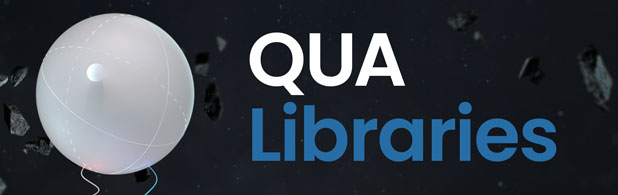

<!-- Netlify (docs deploy) and Zenodo (citable DOI) badges are placeholders;
     fill in the IDs once this repo has its own Netlify site and Zenodo record. -->

# QUA Libraries – Superconducting Qubits

Hey! Glad to see you there!

Welcome to the QUA libraries for superconducting qubits. This repo shares useful tools, examples, and calibration protocols that can jump-start many common tasks for superconducting-transmon experiments with the OPX.

It includes:
* The ["Quantum Control Applications"](./Quantum-Control-Applications)
  folder contains scripts and examples for superconducting qubits, all the way from basic to advanced protocols.
  It also includes various examples and results from labs.
  Note that several codes there make use of the [py-qua-tools](https://github.com/qua-platform/py-qua-tools) that make QUA programs more efficient and easy to write.
  It is thus advised to download the last version.
* The ["QUAlibration Graphs"](./qualibration_graphs)
  folder contains the framework to build calibration nodes and graphs for superconducting qubits using the [QUAM](https://qua-platform.github.io/quam/) framework and [QUAlibrate](https://qua-platform.github.io/qualibrate/) platform.
  The creation of the qubit-specific QUAM structure is made seamless thanks to the set of QUAM components and building functions provided by the [quam-builder](https://github.com/qua-platform/quam-builder) repository.
  The [qualibration-libs](https://github.com/qua-platform/qualibration-libs) repository provides a set of utility functions supporting calibration nodes and graphs.
* The ["Tutorials"](./Tutorials) folder contains an introductory QUAlibrate tutorial.

## Support and Contribution
This is a beta version of the repo, and thus, if you see quirks and inaccuracies please tell us!
Love to see some example that's not yet included? tell us! Have a request for a general purpose procedure? tell us!
Already have something cool that others could use? Open a pull request! You can follow [this guide](./CONTRIBUTING.md) and feel free to contact us if you need any help.
Issue reporting and requests should be done via the [GitHub issues system](https://github.com/qua-platform/qua-libs-superconducting/issues), that should give a transparent experience where all users can see what's coming and which issues are already known.
We hope this repo becomes a useful resource, giving real contribution to the community, and we'd love to see your ideas and contributions too!
